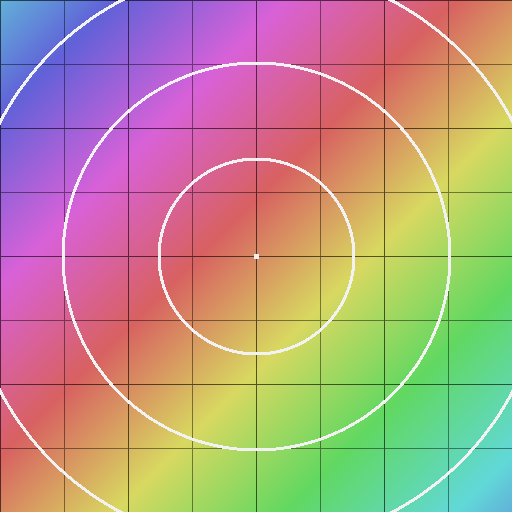

# scop

A 3D `.obj` renderer written in Go against OpenGL 4.1 core, built for the
42 school SCOP project. Everything domain-specific is implemented from
scratch: the `.obj`/`.mtl` parser, the vector/matrix math, ear-clipping
triangulation, automatic UV generation, shader compilation, and the text
overlay. The only external dependencies are the raw OpenGL bindings
(`go-gl/gl`) and window/event management (`go-gl/glfw`); image decoding
uses Go's standard library.



## Build & run

Requires Go ≥ 1.21, a C toolchain, and GLFW build dependencies
(`libgl1-mesa-dev xorg-dev` on Debian/Ubuntu).

```sh
make            # build ./scop
make run        # run with models/42.obj
make run MODEL=models/teapot.obj
make test       # go vet + go test -race ./...
make bench      # allocation benchmarks for the hot paths
make re         # full rebuild
```

Direct invocation:

```sh
./scop [flags] [model.obj]
```

| Flag | Default | Meaning |
|---|---|---|
| `-texture path` | — | texture image (PNG/JPEG); overrides mtl `map_Kd` |
| `-speed rad/s` | `0.8` | self-rotation speed |
| `-width`, `-height` | `1280`, `720` | initial window size |
| `-uv mode` | `auto` | UV generation: `auto`, `planar`, `cylindrical`, `spherical` |
| `-vsync` | `true` | synchronize buffer swaps |
| `-debug` | `false` | log frame timings + allocs/frame to stdout |
| `-wireframe-start` | `false` | start with wireframe overlay on |

## Controls

| Input | Action |
|---|---|
| mouse drag | orbit camera around the model |
| shift-drag / middle-drag | pan |
| scroll | zoom |
| `WASD` + mouse | move / look (fly mode); `Space`/`LeftCtrl` up/down |
| `C` | toggle camera mode (orbit ↔ free-fly) |
| arrows / `IJKL` | translate object on X and Y |
| `U` / `O` | translate object on Z |
| `T` | toggle flat color ↔ texture (0.4 s smooth crossfade) |
| `F` | toggle wireframe overlay |
| `R` | reset camera and object transforms |
| `F1` | toggle FPS / frame-time overlay |
| `F2` | toggle VSync |
| `F11` | toggle fullscreen |
| `F12` | screenshot to timestamped PNG |
| `Esc` | quit |

## Architecture

```
cmd/scop/            flag parsing, input dispatch, render loop
cmd/gentexture/      one-shot generator for models/default_texture.png
internal/objparser/  .obj + .mtl parsing, ear clipping, UV generation
internal/mathgl/     vec2/3/4, column-major mat4, perspective, lookAt
internal/renderer/   shaders, VAO/VBO/EBO, textures, overlay, frustum, screenshot
internal/camera/     orbit + free-fly camera state (pure math, no GL)
internal/window/     GLFW window, context, input collection
shaders/             GLSL sources, embedded into the binary via go:embed
models/              42 logo + teapots + generated default texture
```

Data flow: `objparser.ParseOBJ` → `Mesh` (deduplicated interleaved
vertices, triangle indices, material groups, bbox) → `GenerateUVs` if the
file ships no `vt` → `renderer.UploadMesh` → one `GLMesh` drawn per
material group each frame.

Notable implementation choices:

- **Rotation center** — the model matrix is `T(offset)·T(c)·Ry(θ)·T(-c)`
  with `c` the bounding-box center, so any model spins around its own
  central vertical axis regardless of where it sits in model space.
- **Per-face grayscale without duplicating vertices** — face shade derives
  from `gl_PrimitiveID` in the fragment shader and flat normals come from
  `dFdx/dFdy` derivatives, so vertices stay fully deduplicated and indexed.
- **Triangulation** — ear clipping over the polygon projected onto its
  Newell-normal plane; handles concave polygons, collinear/duplicate
  points, and non-coplanar faces (the "ambiguous" teapot).
- **Auto-UV** — bbox proportions pick cylindrical (elongated), planar
  (flat, e.g. the 42 logo), or spherical (the teapot); wrapping
  projections duplicate vertices along the u-seam so no triangle spans
  the wrap.
- **MTL** — `Ka/Kd/Ks/Ns/map_Kd` parsed per material; faces grouped by
  `usemtl` into contiguous index ranges, sorted by texture to minimize GL
  state changes; missing files degrade to a default material with a
  warning.

## Performance

- Single VAO/VBO/EBO per model, uploaded once; indexed drawing with
  vertices deduplicated by `(v,vt,vn)` triple during parse.
- Concurrent parsing: worker goroutines pre-parse vertex floats and face
  index ints per line-aligned chunk; a sequential replay resolves
  position-dependent state (negative indices, `usemtl` scope) so output
  is deterministic and identical to the sequential reference
  (teapot: 9.9 ms → 7.0 ms, race-clean).
- Zero steady-state heap allocations in the render loop (measured
  0.06 allocs/frame with `-debug`; the residual is the debug log line).
  Math and frustum hot paths benchmark at 0 B/op.
- Frustum culling: Gribb–Hartmann plane extraction + positive-vertex AABB
  test against the model's world-space bounding box.
- FPS overlay renders from a hand-drawn 8×8 bitmap font atlas with a
  preallocated dynamic vertex buffer.

## Manual GL verification checklist

Unit tests cover the parser, triangulation, UV generation, math, camera,
and frustum. GL behavior needs eyes:

1. `make run` — 42 logo spins around its central vertical axis,
   grayscale faces distinguishable, perspective correct.
2. `make run MODEL=models/teapot.obj` — raw teapot renders without holes
   or shading artifacts (inconsistent winding is tolerated).
3. `T` crossfades to texture over ~0.4 s and back; mid-fade toggles
   reverse smoothly.
4. `F` shows thin dark wireframe with no z-fighting shimmer.
5. Orbit/pan/zoom, `C` into fly mode (cursor captured), WASD+look, `R`
   resets everything.
6. Arrows/`IJKL`/`U`/`O` move the object on all three axes.
7. `F1`/`F2`/`F11`/`F12` toggle overlay/vsync/fullscreen and save a
   screenshot.

